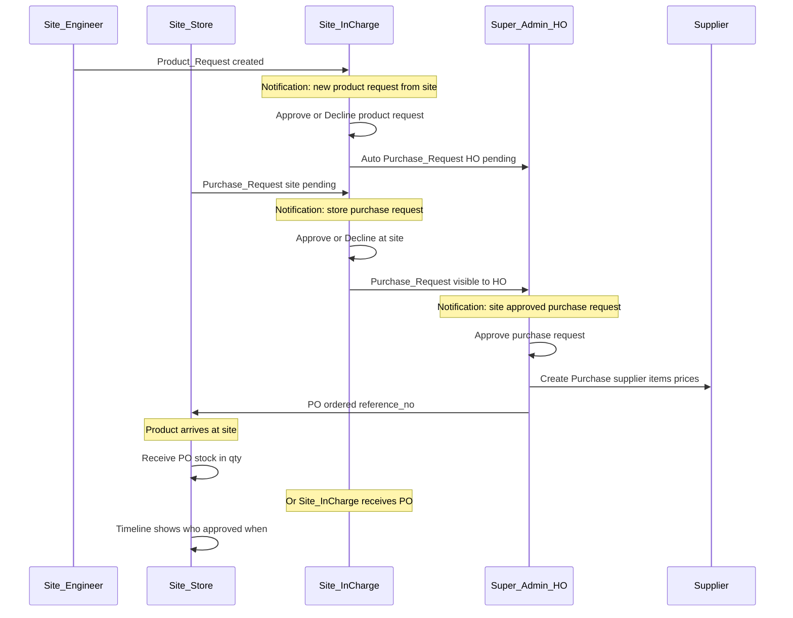
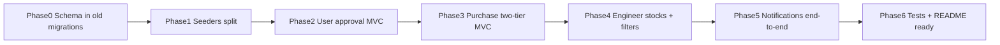

# Panchmukhi ERP — Production-Ready Implementation Plan

> **Goal:** Project ko production-ready banana — pura role matrix, complete Controller + View + Route, database **sirf purani migration files edit**, alag-alag **Seeders**, aur **Notifications** section.

**End-to-end workflow (confirmed):**



| Step | Kya hota hai | Kaun | Dikhega kahan |
|------|----------------|------|----------------|
| 1 | **Product request** site se (Engineer) | Engineer → **In-Charge** | Notification In-Charge; timeline on show |
| 2 | In-Charge product request approve | In-Charge | Optional auto purchase request → HO queue |
| 3 | **Purchase request** (Store items+qty) | Store → **In-Charge pehle** | HO queue me tabhi jab `site_status=approved` |
| 4 | In-Charge purchase approve/decline | In-Charge | Notification requester + HO admins |
| 5 | HO purchase request approve | Super Admin | Notification site users |
| 6 | HO **Purchase order** — supplier select, items, qty, price, reference | Super Admin | `admin/purchases/create` linked to approved PR |
| 7 | Maal site par pahuncha | — | PO status `ordered` |
| 8 | **Site receipt / OK** — stock in qty | **Store In-Charge ya Site In-Charge** | `site/purchases/receive`; record `received_by` |
| 9 | **Approval timeline** | Sab roles | Har request/PO show page par: kab, kisne, approve/decline |

- Site users: **Super Admin approve** before login (unchanged)

---

## 1. Database — sirf existing migrations edit (no new migration files)

Fresh install: `php artisan migrate:fresh --seed`

| File | Changes |
|------|---------|
| [database/migrations/0001_01_01_000000_create_users_table.php](database/migrations/0001_01_01_000000_create_users_table.php) | Add `notifications` table (Laravel standard: `uuid`, `type`, `notifiable`, `data`, `read_at`) |
| [database/migrations/2026_06_02_120000_create_roles_table.php](database/migrations/2026_06_02_120000_create_roles_table.php) | On `users` (after `role_id`): `approval_status` default `approved`, `created_by` nullable FK, `rejection_reason` nullable |
| [database/migrations/2026_06_02_100000_create_erp_schema.php](database/migrations/2026_06_02_100000_create_erp_schema.php) | `purchase_requests`: site approval cols; `purchases`: `received_by`, `received_at`, **price/GST header cols** (§1b); `purchase_items`: **GST line cols** (§1b); indexes |

**Enums (app):** `UserApprovalStatus`, `SiteRequestStatus` (reuse or extend `RequestStatus` for site/HO columns).

### 1b. Purchase price + GST (HO purchase create time)

**Abhi:** `purchase_items` me sirf `unit_price`; show page par price/GST nahi. Supplier par `gstin` hai lekin purchase line par tax nahi.

**Purchase banate waqt (Super Admin)** — har product line par price + GST detail:

**`purchase_items` (edit same migration):**

| Column | Type | Notes |
|--------|------|--------|
| `unit_price` | decimal(12,2) | Rate per unit (**GST exclusive**, taxable base) |
| `gst_rate` | decimal(5,2) default 0 | e.g. 0, 5, 12, 18, 28 (%) |
| `taxable_amount` | decimal(12,2) | `unit_price × quantity` (store ya compute) |
| `cgst_amount` | decimal(12,2) default 0 | Intra-state: half of GST |
| `sgst_amount` | decimal(12,2) default 0 | Intra-state: half of GST |
| `igst_amount` | decimal(12,2) default 0 | Inter-state: full GST in IGST |
| `line_total` | decimal(12,2) | taxable + cgst + sgst + igst |

**`purchases` (header):**

| Column | Type | Notes |
|--------|------|--------|
| `is_interstate` | boolean default false | false → CGST+SGST; true → IGST only |
| `supplier_invoice_no` | string nullable | Supplier bill / invoice number |
| `supplier_invoice_date` | date nullable | Bill date |
| `subtotal` | decimal(12,2) | Sum of taxable_amount |
| `total_cgst` | decimal(12,2) | |
| `total_sgst` | decimal(12,2) | |
| `total_igst` | decimal(12,2) | |
| `total_gst` | decimal(12,2) | cgst+sgst+igst |
| `grand_total` | decimal(12,2) | subtotal + total_gst |
| `received_by`, `received_at` | (pehle se plan me) | Site receipt |

**Calculation (server-side `PurchasePricingService` ya controller):**
- User enters: qty, unit_price, gst_rate %, `is_interstate` on form
- Auto: `taxable = round(unit_price * qty, 2)`
- GST amount = `taxable × gst_rate / 100`
- If **intra-state**: `cgst = sgst = gst/2`, `igst = 0`
- If **inter-state**: `igst = gst`, `cgst = sgst = 0`
- `line_total = taxable + cgst + sgst + igst`
- Header totals = sum of lines

**UI — [admin/purchases/create.blade.php](resources/views/admin/purchases/create.blade.php):**
- Header: supplier (GSTIN read-only from supplier), `is_interstate` checkbox, invoice no/date
- Per line (dynamic rows): Product | Qty | **Unit price** | **GST %** (select 0/5/12/18/28) | Taxable | CGST | SGST | IGST | **Line total** (readonly, JS preview + server validate)
- Footer summary card: Subtotal | CGST | SGST | IGST | **Grand total**
- Small JS: rate change par line + grand totals update (server final authority on save)

**UI — [admin/purchases/show.blade.php](resources/views/admin/purchases/show.blade.php):**
- Table columns: Product, Qty, Unit price, GST%, Taxable, CGST, SGST, IGST, Line total
- Header block: Supplier GSTIN, invoice no/date, grand total breakdown
- Site receive page: price/GST **read-only** (sirf qty receive)

**Model:** `PurchaseItem` accessors; `Purchase` rollups; validation rules in `PurchaseController@store`

**Tests:** `PurchaseGstCalculationTest` — intra-state 18% → 9+9; inter-state 18% → igst only; grand_total matches sum

---

## 2. Seeders — alag-alag files

[database/seeders/DatabaseSeeder.php](database/seeders/DatabaseSeeder.php) sirf orchestrator:

```php
$this->call([
    RoleSeeder::class,           // system roles (from roles migration logic)
    SiteSeeder::class,           // Main Plant PLT-001
    SupplierSeeder::class,
    ProductCatalogSeeder::class, // category, sub, brand, unit, 2 products
    UserSeeder::class,           // all demo logins (see below)
]);
```

| Seeder | Data |
|--------|------|
| **RoleSeeder** | super_admin, site_in_charge, site_engineer, site_store_in_charge |
| **SiteSeeder** | Main Plant |
| **SupplierSeeder** | Demo Supplier |
| **ProductCatalogSeeder** | Raw Materials / Cement / products |
| **UserSeeder** | `admin@`, `site@` (in-charge), `engineer@`, `store@` — sab `approval_status=approved`, `is_active=true` |

Optional: `DemoRequestSeeder` for sample pending product/purchase requests (dev only).

---

## 3. Notifications module (naya section)

### 3.1 Kya dikhega (priority messages)

| Event | Message example | Recipient |
|-------|-----------------|-----------|
| **Naya product request site se** | "New product request #12 from Main Plant — Rahul (Engineer)" | **Site In-Charge** (us site ke) |
| Product request approve/decline | "Your product request #12 was approved by Site In-Charge" | Requester (Engineer) |
| **Store purchase request** | "Purchase request #8 from Store — pending your approval" | **Site In-Charge** |
| Purchase site declined | "Purchase request #8 declined by Site In-Charge" | Store + requester |
| Purchase site approved | "Purchase request #8 approved at site — pending HO" | Super Admin(s) + site requester |
| HO purchase approve/decline | "HO approved purchase request #8" | Site In-Charge, Store, requester |
| PO ready to receive | "Purchase PO-XXX ordered — awaiting receipt at site" | Store + In-Charge |
| Site receipt done | "Stock received for PO-XXX by Store In-Charge" | In-Charge + HO (optional) |
| Site user pending | "New site user pending HO approval" | Super Admin |

Notification `data` JSON: `type`, `title`, `body`, `url` (direct link to show page), `site_id`, `request_id`.

### 3.1 Backend

- `User` model: `Notifiable` + database channel
- `app/Notifications/*` — classes in table above
- Dispatch on: product request `store`, site/HO approve/decline, purchase store `store`, site receive PO
- **In-Charge** inbox: filter types `product_request_new`, `purchase_request_site_pending`
- **HO** inbox: `purchase_request_ho_pending` (only `site_status=approved`)

### 3.2 Controllers + routes + views

| Portal | Controller | Routes | Views |
|--------|------------|--------|-------|
| Admin | `Admin/NotificationController` | index, mark read, read-all | list with icon per type + link |
| Site | `Site/NotificationController` | same | same |

### 3.3 UI

- Topbar **bell** + unread badge + dropdown (last 5, "View all")
- Full page: type badge, time ago, click → `product-requests/{id}` / `purchase-requests/{id}` / `purchases/receive`
- Sidebar: **Notifications** link (admin + site)

---

## 3b. Approval timeline (kab kon approve kiya)

**No extra table** — existing columns se timeline; Blade component `x-approval-timeline`.

| Entity | Timeline steps |
|--------|----------------|
| **Product request** | Submitted (user, datetime) → Site In-Charge reviewed (approve/decline, user, datetime) → Linked purchase request # |
| **Purchase request** | Submitted (Store/user) → **Site In-Charge** (site_status, user, datetime) → **HO** (status, reviewed_by, datetime) → Linked PO |
| **Purchase (PO)** | Created by HO (supplier, reference) → Ordered at → **Received at site** (`received_by`, `received_at`, qty lines) |

Show on:
- `site/product-requests/show`, `admin/product-requests/show`
- `site/purchase-requests/show`, `admin/purchase-requests/show`
- `site/purchases/receive` + `admin/purchases/show`

Format: vertical stepper — green approve, red decline, grey pending.

---

## 3c. HO purchase + site receipt (detail)

**HO (Super Admin)** — approved purchase request ke baad:
1. `admin/purchases/create?purchase_request_id=X` — prefill items from PR (qty; price/GST HO bharega)
2. **Supplier select** (required) — supplier **GSTIN** dikhega
3. **Invoice no / date**, **inter-state** flag
4. Har line: product, qty, **unit price**, **GST %**, auto CGST/SGST/IGST + **line total** (§1b)
5. Footer: subtotal, total GST, **grand total**
6. Save → status `ordered`; notify site Store + In-Charge

**Site par maal aane par** — **Store In-Charge OR Site In-Charge**:
1. `site/purchases` — ordered PO list
2. `site/purchases/{id}/receive` — line-wise receive qty
3. Submit → `StockService::recordInFromPurchase`, `received_by = auth()->id()`, `received_at = now()`, status `delivered`
4. Timeline step "Received at site" update

**Rule:** Store ka purchase request **kabhi seedha HO par nahi** — hamesha `site_status=pending` until In-Charge approves.

---

## 4. Complete Controller / View / Route checklist

Har module ke liye **index, create, store, edit, update** (jahan spec me ho) + **show** jahan tracking chahiye.

### 4.1 Super Admin — [routes/admin.php](routes/admin.php)

| Module | Controller | Views folder | Status |
|--------|------------|--------------|--------|
| Dashboard | `DashboardController` | `admin/dashboard` | Done — polish tiles |
| Sites | `SiteController` | `admin/sites/*` | Done |
| Suppliers | `SupplierController` | `admin/suppliers/*` | Done |
| Roles | `RoleController` | `admin/roles/*` | Done |
| Users | `UserController` | `admin/users/*` | **Extend:** pending tab, approve/reject |
| Users access queue | same + actions | pending list partial | **New UI** |
| Categories … Products | existing resources | done | Done |
| Product requests | `ProductRequestController` | `admin/product-requests/*` | Done |
| Purchase requests | `PurchaseRequestController` | `admin/purchase-requests/*` | **Extend:** only `site_status=approved` in queue |
| Purchases + Stock In | `PurchaseController` | create/show + GST cols | **Extend:** §1b price/GST on create/show |
| Stocks + Stock Out | `StockController` | `admin/stocks/*` | Done |
| Product use | `ProductUseEntryController` | done | Done |
| Reports | `ReportController` | consumption CSV | Done |
| **Notifications** | `NotificationController` | `admin/notifications/*` | **New** |
| Profile | `ProfileController` | `admin/profile/*` | Done |

### 4.2 Site portal — [routes/site.php](routes/site.php)

| Module | Role | Controller | Views | Status |
|--------|------|------------|-------|--------|
| Dashboard | all | `Site/DashboardController` | `site/dashboard` | Done — role widgets Phase C |
| **Users** | In-Charge | `Site/UserController` | `site/users/index,create,edit` | **New full CRUD** |
| Product requests | In-Charge, Engineer | `Site/ProductRequestController` | index/create/show | Done — filters Phase C |
| PR approve/decline | In-Charge | same | show actions | Done |
| Purchase requests | view: all; create: Store | `Site/PurchaseRequestController` | **Extend:** site approve, tabs |
| PR site approve | In-Charge | new methods | show | **New** |
| Stocks | In-Charge, Store, **Engineer** | `Site/StockController` | index, stock-out | Engineer access Phase D |
| Receive PO | In-Charge, Store | `Site/PurchaseController` | index, receive | Done |
| Product use | — | remove from Engineer menu | align spec → stock out only |
| **Notifications** | all site | `Site/NotificationController` | `site/notifications/*` | **New** |
| Profile | all | `site/profile` dedicated routes | **New — see §4.3** |

### 4.3 Site profile routes (thik se — admin jaisa pattern)

**Problem (abhi):** Site topbar `route('profile.edit')` → `/profile` → Breeze `x-app-layout` ([profile/edit.blade.php](resources/views/profile/edit.blade.php)), site portal theme se match nahi karta. Admin ke paas alag `/admin/profile` + `admin.profile.*` hai.

**Target:** Site users ke liye **`/site/profile`** prefix, `layouts.site`, named routes `site.profile.*`.

| Method | URI | Route name | Middleware |
|--------|-----|------------|------------|
| GET | `/site/profile` | `site.profile.edit` | `auth`, `site_user` |
| PATCH | `/site/profile` | `site.profile.update` | `auth`, `site_user` |
| PUT | `/site/profile/password` | `site.password.update` | `auth`, `site_user` |
| DELETE | `/site/profile` | `site.profile.destroy` | `auth`, `site_user` |

**[routes/site.php](routes/site.php)** — group ke andar (dashboard ke baad):

```php
Route::get('profile', [ProfileController::class, 'editSite'])->name('profile.edit');
Route::patch('profile', [ProfileController::class, 'updateSite'])->name('profile.update');
Route::put('profile/password', [PasswordController::class, 'update'])->name('password.update');
Route::delete('profile', [ProfileController::class, 'destroySite'])->name('profile.destroy');
```

**Controller:** [ProfileController](app/Http/Controllers/ProfileController.php) — methods (ya `Site\ProfileController` thin wrapper):
- `editSite()` → view `site.profile.edit`, user + `site`, `role` loaded
- `updateSite()` → validate via `ProfileUpdateRequest`, redirect `site.profile.edit`
- `destroySite()` → same as admin; redirect `/login`

**View:** `resources/views/site/profile/edit.blade.php`
- `@extends('layouts.site')`
- `@section('title', 'Profile')`
- `x-admin-page-header` — "My Profile", back link `site.dashboard`
- Summary card: avatar initial, name, email, **role badge**, **plant name** (`$user->site`)
- Reuse partials: `profile.partials.update-profile-information-form`, `update-password-form`, `delete-user-form` with routes:
  - `site.profile.update`, `site.password.update`, `site.profile.destroy`

**Redirects / links:**

| Location | Change |
|----------|--------|
| [routes/web.php](routes/web.php) `GET /profile` | Super Admin → `admin.profile.edit`; **site user → `site.profile.edit`** |
| [site-topbar.blade.php](resources/views/partials/site-topbar.blade.php) | `route('site.profile.edit')` |
| [ProfileController::update](app/Http/Controllers/ProfileController.php) | Site role → redirect `site.profile.edit` |
| [site-sidebar-menu](resources/views/partials/site-sidebar-menu.blade.php) | Optional footer link "Profile" |

**Legacy `/profile`:** Site users ke liye redirect only; PATCH/DELETE on web.php hata sakte ho ya sirf super-admin-less users ke liye `site.profile.*` use karo — recommend **web.php profile routes** sirf redirect helper:

```php
Route::get('/profile', function () {
    $user = auth()->user();
    if ($user->isSuperAdmin()) {
        return redirect()->route('admin.profile.edit');
    }
    if ($user->hasSiteRole()) {
        return redirect()->route('site.profile.edit');
    }
    return app(ProfileController::class)->edit(request());
})->middleware('auth')->name('profile.edit');
```

Global `profile.update` / `profile.destroy` hata ke site + admin alag rakho (password bhi).

**Tests:** `SiteProfileTest` — site user GET `site.profile.edit` 200 + sees plant name; engineer forbidden from `admin.profile.edit`.

---

## 5. Implementation phases (execution order)



### Phase 0 — Schema (old migrations only)
- Edit 3 migration files as §1
- Update models: `User`, `PurchaseRequest` fillable/casts/scopes

### Phase 1 — Seeders
- Create 5 seeders; slim `DatabaseSeeder`
- Demo emails documented in README

### Phase 2 — Site users + HO approval (full MVC)
- `Site/UserController` + 3 views + routes
- `Admin/UserController`: pending queue, approve, reject
- `LoginRequest`: block pending/rejected
- Tests: `SiteUserProvisioningTest`

### Phase 3 — Purchase two-tier + HO PO + GST + site receipt (full MVC)
- Store `store()` → `site_status=pending` only; In-Charge approve/decline routes + timeline on show
- HO index: `site_status=approved` AND `status=pending`
- HO approve → `admin/purchases/create` from PR; supplier + **unit price + GST per line** + invoice + grand total (§1b)
- `PurchasePricingService` for CGST/SGST/IGST split
- Site receive: `received_by` / `received_at`; price/GST read-only on receive form
- Tests: Store→IC→HO→PO→receive chain + `PurchaseGstCalculationTest`

### Phase 4 — UX + Engineer stocks + Site profile routes
- **`site.profile.*` routes** + `site/profile/edit` view (§4.3)
- `web.php` redirect site users to `site.profile.edit`
- `canManageSiteStocks()` includes engineer; routes updated
- Shared list filters on site modules
- Role-specific dashboard cards
- Remove Engineer **Product Use** from sidebar (HO admin keeps it)

### Phase 5 — Notifications + timeline UI
- All notification classes (§3.1 table); **product request from site** → In-Charge first priority
- Topbar bell + full list pages
- `x-approval-timeline` on all request/PO show pages
- Tests: product request notifies In-Charge; store PR notifies In-Charge only (not HO until site approved)

### Phase 6 — Project ready
- `php artisan test` — target 46+ tests
- [README.md](README.md) — setup, all demo logins, role table, notification note
- Manual QA checklist per role

---

## 6. Demo logins (after UserSeeder)

| Email | Role |
|-------|------|
| admin@panchmukhi.test | Super Admin |
| site@panchmukhi.test | Site In-Charge |
| engineer@panchmukhi.test | Site Engineer |
| store@panchmukhi.test | Site Store In-Charge |

Password: `password`

---

## 7. Completion targets

| Area | Current | After plan |
|------|---------|------------|
| Super Admin | ~92% | 100% + notifications |
| Site In-Charge | ~65% | 100% |
| Site Store | ~75% | 100% |
| Site Engineer | ~50% | 100% |
| Database/seed | monolithic | migrations edited + modular seeders |
| Notifications | none | full in-app bell + list pages |

---

## 8. Execution command (when you say "implement")

```bash
php artisan migrate:fresh --seed
php artisan test
php artisan serve
```

**Note:** Existing DB par sirf `migrate` kaam nahi karega agar purani migrations edit ki hain — fresh migrate required.
